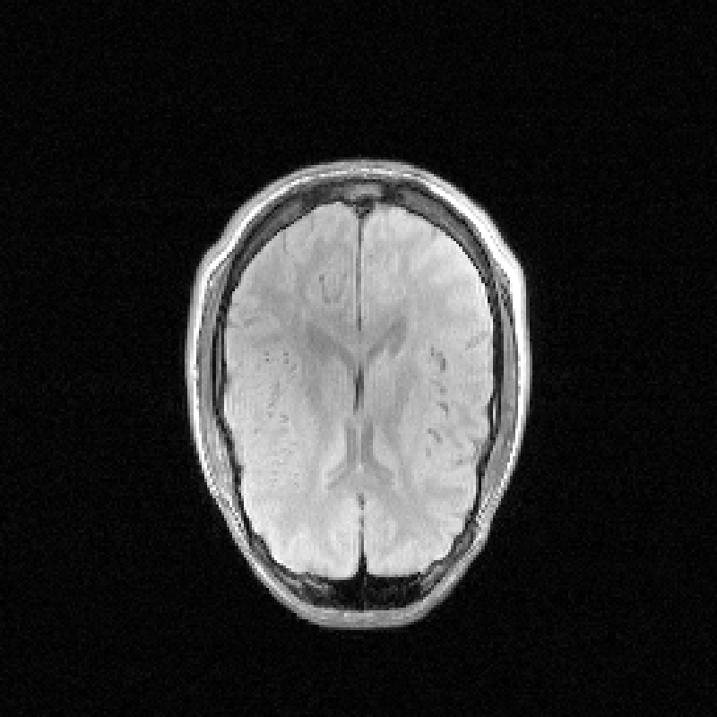
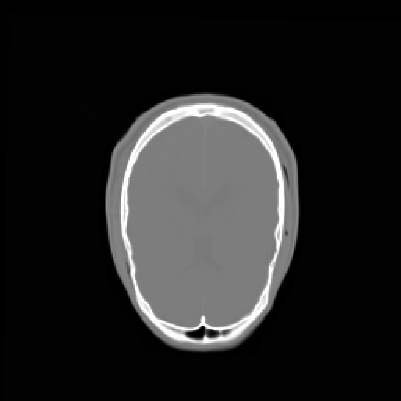

# RIRE head CT-MRI example

This example contains real head images from the Retrospective Image Registration Evaluation (RIRE) dataset, case `patient_001`. The images depict the brain and surrounding cranial structures.

| File | Role | Modality | Size (x, y, z) | Voxel spacing (mm) |
| --- | --- | --- | --- | --- |
| `data/moving.nii.gz` | Moving image | CT | 512 x 512 x 28 | 0.653595 x 0.653595 x 4.000000 |
| `data/fixed.nii.gz` | Fixed image | PD-weighted MRI, rectified | 256 x 256 x 26 | 1.265695 x 1.265695 x 4.113600 |
| `data/source.json` | Source identifiers, geometry and file hashes | JSON | | |

## Run the example

From the package root, install the software dependencies and run:

```sh
python -m pip install -r Software/requirements.txt
python Software/one_click_registration.py \
  --moving-image Software/examples/data/moving.nii.gz \
  --fixed-image Software/examples/data/fixed.nii.gz \
  --moving-modality CT --fixed-modality MRI \
  --num-samples 10000 --threads 1 \
  --output-dir run_outputs/rire_example
```

In the GUI, select the same two files, choose CT for the moving image and MRI for the fixed image, and select a new or empty output folder. See [Software README](../README.md#outputs) for the generated files.

## Example images

The two images below show the same central z slice on the fixed MRI grid, after running this pair with 10,000 points per image and one numerical thread. They are the `fixed_z.png` and `registered_z.png` views from the six grayscale images produced by the application, saved here under descriptive example filenames.

| Fixed MRI | Registered CT |
| --- | --- |
|  |  |

`fixed_mri_axial.png` shows the reference MRI, and `registered_ct_axial.png` shows the CT after registration. Both use native z slice index 13 (zero-based) and the same physical aspect ratio. Display limits are the first and 99th intensity percentiles of each volume independently. The registered CT window uses only voxels covered by the source CT; areas outside source coverage are black. These grayscale display settings do not change the image data or registration transform.

## Source and preparation

Source: [RIRE testing datasets](https://rire.insight-journal.org/download_data), `patient_001`, `ct.tar.gz` and `mr_PD_rectified.tar.gz`.

The supplied files were converted from the local MetaImage volumes to compressed NIfTI with SimpleITK. Voxel values, image dimensions and spatial geometry were preserved within NIfTI floating-point precision. No additional resampling, cropping, intensity scaling or artificial transformation was applied. The MRI is the dataset's rectified PD-weighted image. Geometry follows the local MetaImage headers. `data/source.json` records the source files and conversion details.

## Attribution and license

The images were provided as part of the Retrospective Image Registration Evaluation project, National Institutes of Health, Project Number 8R01EB002124-03, Principal Investigator J. Michael Fitzpatrick, Vanderbilt University, Nashville, TN.

The [official RIRE download page](https://rire.insight-journal.org/download_data) identifies the dataset license as [Creative Commons Attribution 3.0 United States](https://creativecommons.org/licenses/by/3.0/us/). The original accompanying notice is preserved in [RIRE_LICENSE.txt](RIRE_LICENSE.txt). That historical notice uses the wording “3.0 Unported”; both source references are retained here. The images retain their dataset license independently of the FOTMIR software license.
